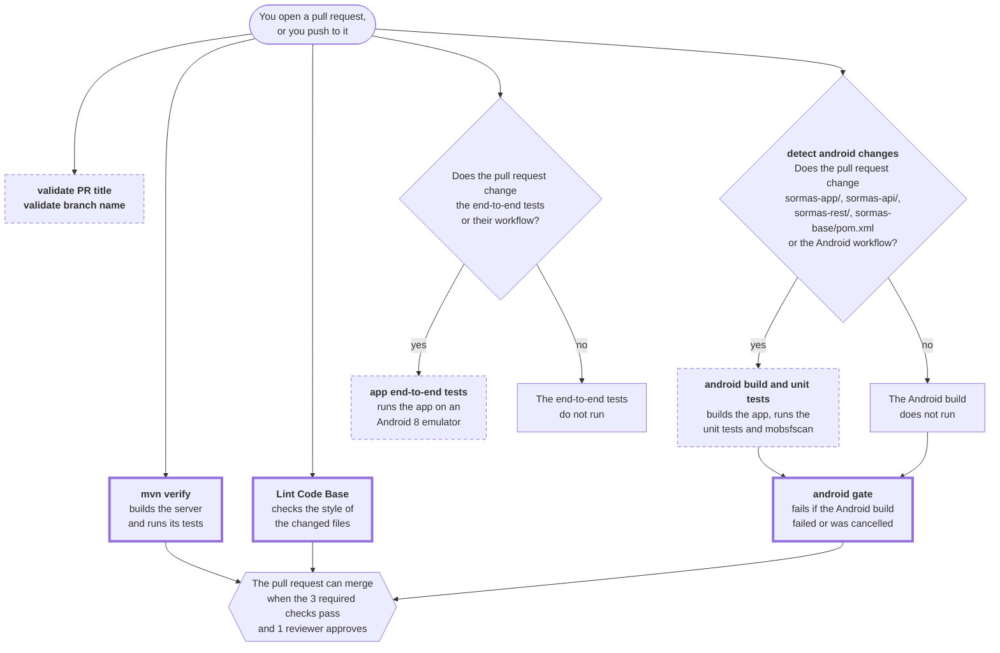

# How to read the tests and the checks

This page is for developers who open a pull request. It tells you what each check does, where to find its result, and what to do when a test fails.

## The checks on a pull request

Each push to a pull request starts the checks again. The diagram shows when each check runs. A check with a **thick border** is required: it must pass before the pull request can merge. A check with a **dashed border** does not block a merge.



The table gives more detail about each check.

| Check | What it does | Required |
|---|---|---|
| `mvn verify` | Builds the server modules and runs their tests. | yes |
| `Lint Code Base` | Checks the style of the files that the pull request changes. It does not check the generated files in `openapi/`. | yes |
| `android gate` | Gives one result for the Android checks. It passes when the Android build passes or does not run. It fails when the build fails or is cancelled. | yes |
| `detect android changes` | Finds out if the pull request changes the app. If not, the Android build does not run. | no |
| `android build and unit tests` | Builds the debug app and runs the app unit tests. | no, but `android gate` reports its result |
| `app end-to-end tests` | Starts the app on an Android 8 emulator and runs the end-to-end tests. It runs only when a pull request changes these tests or their workflow. | no |
| `validate PR title` | The title must start with a type, for example `fix:` or `test(app):`. | no |
| `validate branch name` | The branch name must start with `test/`, `ci/`, `fix/`, `docs/`, `chore/` or `feat/`. | no |
| `mobsfscan` | A security scan of the app code. It gives advice only. | no |

## How to find the result of a check

1. Open the pull request and click the **Checks** tab. You can also click **Details** next to a check.
2. Click the job name. A failed step has a red mark. Open that step.
3. The cause of the failure is usually near the end of the log.

Each check also has these results:

| Check | Where to find the results |
|---|---|
| `android build and unit tests` | The **Summary** page of the run shows the table "Android unit tests": the number of tests and failures for each test class. The artifact `android-unit-test-report` contains the full HTML report. Open `reports/tests/testDebugUnitTest/index.html`. |
| `app end-to-end tests` | The artifact `app-e2e-report` contains the HTML report (`reports/androidTests/connected/index.html`), the XML results, and `logcat.txt`, the full log of the emulator. |
| `mvn verify` | Read the log. Search for `Tests run:` and `BUILD FAILURE`. The module name is in the lines above the failure. |
| `Lint Code Base` | The log gives the file, the line and the rule. |

To download an artifact, open the run page and go to the **Artifacts** section at the bottom.

### When `android gate` fails

`android gate` does not test anything itself. It only reports the result of the Android build. Thus, open `android build and unit tests` to find the real failure.

## How to read a failed test

### Sync mapping tests (`*SyncMappingTest`)

Each sync mapping test checks one `DtoHelper`. It finds each field that is on both the server DTO and the phone entity, and it makes sure that the helper copies the field in each direction.

| In the message | Direction | Method in the helper |
|---|---|---|
| `server -> phone` | pull | `fillInnerFromDto` |
| `phone -> server` | push | `fillInnerFromAdo` |

Example of a failure:

```text
CampaignFormMetaRegion <-> CampaignFormMetaRegionDto
  fields on both sides: 2
  server -> phone, NOT copied by fillInnerFromDto: [area_id]
expected:<[]> but was:<[area_id]>
```

This message means: `area_id` is on the DTO and on the entity, but `fillInnerFromDto` does not copy it. Thus, the phone never gets this value from the server.

What to do:

- **The field must be copied:** add the copy line to the helper. For this example: `target.setArea_id(source.getArea_id());` in `fillInnerFromDto`.
- **The field must not be copied:** add it to the list `NOT_COPIED_TO_PHONE` or `NOT_COPIED_TO_SERVER` in the test, with the reason.

The usual cause: you added a field to a DTO and to an entity, but not to the helper.

### Save and reload (`CampaignFormDataRoundTripTest`)

This test saves campaign form values in the same way as the local database, loads them again, and compares them. A failure gives the value that went in and the value that came back. For example:

```text
Expected: is "007"
     but: was "7"
```

The cause is a change in how `CampaignFormData` converts the form values to JSON and back.

The last three tests record values that change type: a whole number comes back as a decimal, `YesNo` comes back as text, and a `Date` comes back as text. If one of these tests fails, the conversion changed. Make sure that the change is intended.

### Push payload (`CampaignFormDataPushPayloadTest`)

This test checks that each saved value is in the JSON that the phone sends to the server. A failure names the entry:

```text
The push does not send the entry "dropped"
The push sends a different value for "decimal"
```

The cause is a change in `CampaignFormDataDtoHelper.fillInnerFromAdo`, or in the Gson configuration in `RetroProvider.initGson()`.

### End-to-end tests (`de.symeda.sormas.app.e2e`)

Open the HTML report in the artifact `app-e2e-report`. If a test failed, search `logcat.txt` for `FATAL EXCEPTION` or for the name of the test.

This message means that the tests were given the production server:

```text
The end-to-end tests must not use the production server: ...
```

The end-to-end tests stop before they open a screen, so they cannot write test data to the live system.

## How to run the tests on your computer

The server tests:

```bash
cd sormas-base
mvn verify
```

The app unit tests need the Android SDK and `sormas-api` in your local Maven repository:

```bash
cd sormas-base
mvn install -pl :sormas-api -am -DskipTests

cd ../sormas-app
./gradlew :app:testDebugUnitTest

# Only one test class:
./gradlew :app:testDebugUnitTest --tests '*CampaignFormDataRoundTripTest'
```

The end-to-end tests need an emulator or a device with Android 8 or later:

```bash
cd sormas-app
./gradlew :app:connectedDebugAndroidTest \
  -Pandroid.testInstrumentationRunnerArguments.package=de.symeda.sormas.app.e2e
```

## Where the tests are

| Folder | Tests |
|---|---|
| `sormas-api/src/test/java` | Unit tests of the code that the server and the apps share: `VersionHelperTest`, and the campaign tests `ExpressionProcessorUtilsTest`, `CampaignFormDataEntryTest` and `CampaignFormElementTypeTest`. `mvn verify` runs them. Tests with `@Ignore("#...")` show an open bug. |
| `sormas-app/app/src/test/java/.../backend/common` | The sync mapping harness and its own tests. |
| `sormas-app/app/src/test/java/.../backend/campaign` | The campaign tests: sync mapping, save and reload, push payload. |
| `sormas-app/app/src/androidTest/java/.../e2e` | The end-to-end tests that run on an emulator. |

The other files in `sormas-app/app/src/androidTest` are old SORMAS tests for screens that APMIS does not use. They must compile, but they do not run.
